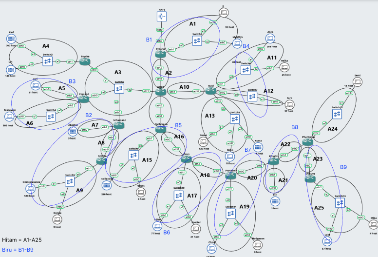
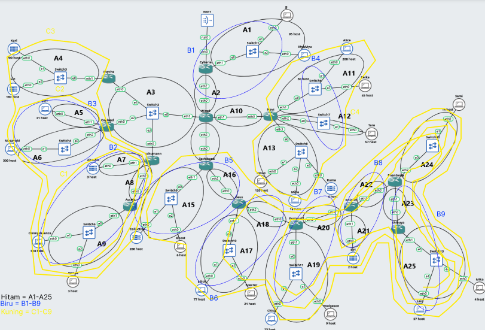
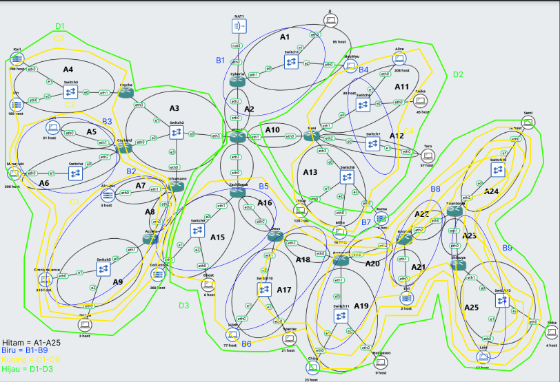
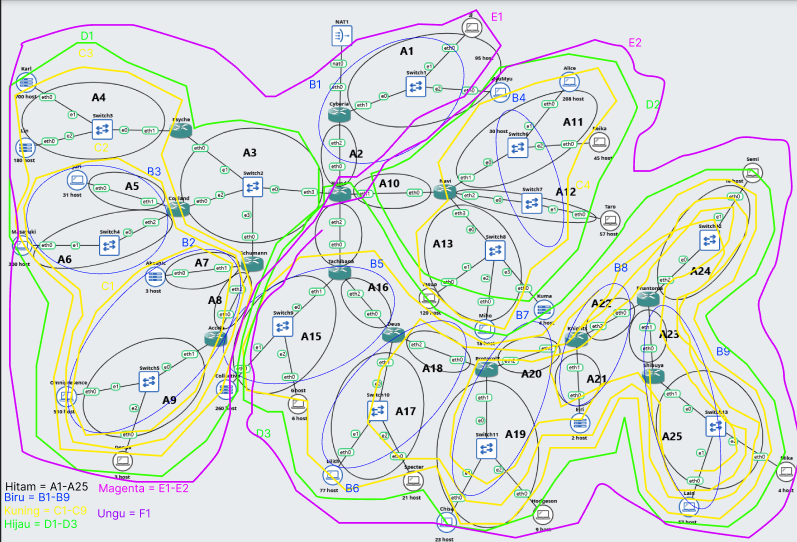
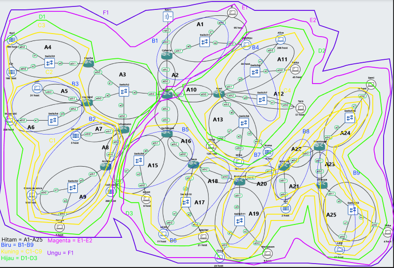

# Jarkom-Modul-4-2026-K-35

----
| Nama | NRP |
| ---------------------- | ---------- |
| Dea Chrisna Butarbutar | 5027251035 |
| Pradipta Airlangga Ramadhan | 5027251118 |
----

# IP Address Host : 10.4.89.247

# IP Prefix : 10.81.x.x

# Serial Experiments Lain - The Wired Expansion

**Link Subnetting**: [Spreadsheet Modul 4 Komdat Jarkom 2026_K35](https://docs.google.com/spreadsheets/d/1kNx5OV6l-Z7Dt_cw2WDNFIgymafBO41x/edit?usp=sharing&ouid=111844958009810909698&rtpof=true&sd=true)

## VLSM - CISCO PACKET TRACER

### Topologi
Berikut gambar topologi menggunakan metode VLSM yang sudah kami rancang di Cisco Packet Tracer.


Dari rancangan topologi tersebut, total subnet yang digunakan adalah 25 subnet dengan jumlah IP sebanyak 2864. Total ukuran blok yang dapat digunakan adalah sebanyak 4138 IP, maka dibutuhkan subnet /19 dengan total 8192 IP. 

### VLSM Tree
Berikut adalah tree yang digunakan dalam pembagian IP pada perhitungan VLSM.


### Subnetting
Hasil subnetting menggunakan metode VLSM adalah sebagai berikut.


#### Perhitungan Pembagian IP
Contoh perhitungan pada **subnet A4**.

#### 1. Prefix
Perhitungan prefix dilakukan dengan menghitung kebutuhan host terlebih dahulu.

- Host = 881 host
- Kebutuhan host = host + 2 -> 881 + 2 = 883 host
- Cari n yang -> 2ⁿ − 2 ≥ kebutuhan host
- Untuk n = 10 -> 2¹⁰ - 2 ≥ 883 (cukup)
- Prefix = 32 - n -> 32 - 10 = 22

Maka, prefix yang didapat adalah /22.

#### 2. Network ID
Network ID adalah IP address awal yang mewakili subnet A4. Ini adalah subnet pertama pada blok 10.81. 0.0, maka NID adalah 10.81.0.0.

#### 3. Broadcast Address
Broadcast address adalah IP setelah range IP yang digunakan. Range IPnya berada pada 10.81.0.1 - 10.81.3.254, maka broadcast addressnya adalah 10.81.3.255.

#### 4. Range IP
Range IP dimulai dari alamat setelah Network ID sampai dengan sebelum broadcast address, yaitu 10.81.8.1 - 10.81.3.254.

### Static IP
Konfigurasi IP statis pada setiap router dan node (PC ataupun laptop) dilakukan dengan hasil dari perhitungan yang ada pada tabel subnetting.
Kami melakukannya dengan manual dengan urutan sebagai berikut.
#### 1. Router: Config > Interface
Contoh konfigurasi pada router **Wired**:
- IPv4 Address: `10.81.16.58`
- Subnet Mask : `255.255.255.252`

#### 2. Node Device: Desktop > IP Configuration > Static
Contoh konfigurasi pada device **Alice** (Laptop)
- IPv4 Address    : `10.81.12.2`
- Subnet Mask     : `255.255.255.0`
- Default Gateway : `10.81.12.1`

### Routing
Routing ini dilakukan agar komunikasi dapat dilakukan antar router atau node.
```
ip route <Destination network ID> <Netmask> <Gateway>
```

- Wired (Pusat)
```
ip route 10.81.14.0 255.255.255.128 10.81.16.57
ip route 10.81.12.0 255.255.254.0 10.81.16.66
ip route 10.81.15.64 255.255.255.192 10.81.16.66
ip route 10.81.0.0 255.255.252.0 10.81.16.34
ip route 10.81.8.0 255.255.254.0 10.81.16.35
ip route 10.81.15.192 255.255.255.192 10.81.16.35
ip route 10.81.4.0 255.255.252.0 10.81.16.36
ip route 10.81.16.40 255.255.255.248 10.81.16.36
ip route 10.81.10.0 255.255.254.0 10.81.16.70
ip route 10.81.14.128 255.255.255.128 10.81.16.70
ip route 10.81.15.128 255.255.255.192 10.81.16.70
ip route 10.81.16.48 255.255.255.248 10.81.16.70
ip route 10.81.16.0 255.255.255.224 10.81.16.70
ip route 10.81.15.0 255.255.255.192 10.81.16.70
```
- Cyberia
```
ip route 0.0.0.0 0.0.0.0 10.81.16.58
```
- Navi
```
ip route 0.0.0.0 0.0.0.0 10.81.16.65
```
- Pysche
```
ip route 0.0.0.0 0.0.0.0 10.81.16.33
```
- Copland
```
ip route 0.0.0.0 0.0.0.0 10.81.16.33
```
- Accela
```
ip route 0.0.0.0 0.0.0.0 10.81.16.61
```
- Shibuya
```
ip route 0.0.0.0 0.0.0.0 10.81.16.89
```
- Schumann
```
ip route 0.0.0.0 0.0.0.0 10.81.16.33
ip route 10.81.4.0 255.255.252.0 10.81.16.62
```
- Tachibana
```
ip route 0.0.0.0 0.0.0.0 10.81.16.69
ip route 10.81.14.128 255.255.255.128 10.81.16.74
ip route 10.81.15.128 255.255.255.192 10.81.16.74
ip route 10.81.16.48 255.255.255.248 10.81.16.74
ip route 10.81.16.0 255.255.255.224 10.81.16.74
ip route 10.81.15.0 255.255.255.192 10.81.16.74
```
- Deus
```
ip route 0.0.0.0 0.0.0.0 10.81.16.73
ip route 10.81.15.128 255.255.255.192 10.81.16.78
ip route 10.81.16.48 255.255.255.248 10.81.16.78
ip route 10.81.16.0 255.255.255.224 10.81.16.78
ip route 10.81.15.0 255.255.255.192 10.81.16.78
```
- Protocol7
```
ip route 0.0.0.0 0.0.0.0 10.81.16.77
ip route 10.81.16.48 255.255.255.248 10.81.16.82
ip route 10.81.16.0 255.255.255.224 10.81.16.82
ip route 10.81.15.0 255.255.255.192 10.81.16.82
```
- Knights
```
ip route 0.0.0.0 0.0.0.0 10.81.16.81
ip route 10.81.16.0 255.255.255.224 10.81.16.86
ip route 10.81.15.0 255.255.255.192 10.81.16.86
```
- Phantoma
```
ip route 0.0.0.0 0.0.0.0 10.81.16.85
ip route 10.81.15.0 255.255.255.192 10.81.16.90
```

## CIDR - GNS3
### Topologi

Berikut gambar topologi GNS3 yang sudah kami beri label subnet A1 sampai A25. Penomoran subnet sama dengan yang dipakai pada VLSM, sehingga hasil kedua metode dapat dibandingkan.


Hanya router Cyberia yang terhubung ke NAT. Dari rancangan tersebut terdapat 25 subnet, terdiri dari 16 subnet LAN (router ke switch atau router ke node) dan 9 link antar-router. Link Cyberia ke NAT tidak dihitung karena alamatnya diberikan oleh NAT GNS3.

### CIDR TREE


### Subnetting
Hasil subnetting menggunakan metode CIDR adalah sebagai berikut.

- Penggabungan


Aturan penggabungan: dua blok digabung menjadi satu blok seukuran 2 x blok yang terbesar, sehingga netmask akhir = netmask terkecil dikurangi 1. Blok yang lebih besar menempati alamat terendah, dan blok yang lebih kecil ditempatkan di awal separuh atas.

Contoh perhitungan:

B1 = A3 (/29, 8 IP) + A2 (/30, 4 IP). 

Blok terbesar 8, maka hasil 2 x 8 = 16 IP = /28.

C3 = A4 (/22, 1024 IP) + B2 (/22, 1024 IP). 

Hasil 2 x 1024 = 2048 IP = /21.

D1 = C3 (/21) + C2 (/21). 

Hasil 2 x 2048 = 4096 IP = /20.

K1 = D1 (/20) + J1 (/20). 

Hasil 2 x 4096 = 8192 IP = /19.

Penggabungan mengikuti cabang topologi (ujung ke arah Cyberia) dan menggabungkan blok kecil lebih dulu agar tidak ada ruang terbuang. Terdapat 24 penggabungan dalam 10 level.

### Visualisasi












- Pembagian IP


Pembagian dilakukan dari atas ke bawah, mulai dari blok akhir K1 = 10.81.0.0/19. Setiap blok dibagi menjadi dua separuh:

Separuh bawah (alamat terendah) diberikan kepada blok yang lebih besar (Gabungan dari 1).
Separuh atas diberikan kepada blok kedua (Gabungan dari 2), dimulai dari alamat awalnya.

Contoh pada K1 (10.81.0.0/19): D1 (/20) mendapat 10.81.0.0/20 (10.81.0.0 - 10.81.15.255), sedangkan J1 (/20) mendapat 10.81.16.0/20 (10.81.16.0 - 10.81.31.255). Contoh pada D1 (10.81.0.0/20): C3 (/21) mendapat 10.81.0.0/21, dan C2 (/21) mendapat 10.81.8.0/21.

### Konfigurasi dan Routing

#### Ringkasan Routing

| Router | Jumlah entri | Isi |
|---|---|---|
| Cyberia | 1 | `10.81.0.0/19` via 10.81.24.138 |
| Wired | 6 | `default` via 10.81.24.137; `10.81.0.0/22` via 10.81.24.130; `10.81.4.0/22` via 10.81.24.131; `10.81.8.0/21` via 10.81.24.132; `10.81.16.0/22` via 10.81.18.66; `10.81.20.0/22` via 10.81.22.194 |
| Psyche | 1 | `default` via 10.81.24.129 |
| Copland | 1 | `default` via 10.81.24.129 |
| Schumann | 2 | `default` via 10.81.24.129; `10.81.8.0/22` via 10.81.12.10 |
| Accela | 1 | `default` via 10.81.12.9 |
| Navi | 1 | `default` via 10.81.18.65 |
| Tachibana | 2 | `default` via 10.81.22.193; `10.81.22.0/23` via 10.81.22.198 |
| Deus | 3 | `default` via 10.81.22.197; `10.81.22.0/24` via 10.81.22.202; `10.81.22.192/30` via 10.81.22.197 |
| Protocol7 | 2 | `default` via 10.81.22.201; `10.81.22.0/25` via 10.81.22.206 |
| Knights | 2 | `default` via 10.81.22.205; `10.81.22.0/25` via 10.81.22.106 |
| Phantoma | 2 | `default` via 10.81.22.105; `10.81.22.0/26` via 10.81.22.110 |
| Shibuya | 1 | `default` via 10.81.22.109 |

Total: 14 entri default/summary + 1 default dari DHCP NAT. Semua pakai summary route hasil penggabungan CIDR (K1, C4, H1, G1, F1, E1, C2, B2).

## Router

### Cyberia

**Network config**
```
auto eth0
iface eth0 inet dhcp

auto eth1
iface eth1 inet static
	address 10.81.24.1
	netmask 255.255.255.128

auto eth2
iface eth2 inet static
	address 10.81.24.137
	netmask 255.255.255.252
```
**Routing**
```
# eth0 dari NAT (DHCP) otomatis membawa default route ke internet
iptables -t nat -A POSTROUTING -o eth0 -s 10.81.0.0/19 -j MASQUERADE
# K1: semua subnet internal lewat Wired (subnet A1 & A2 tetap connected, lebih spesifik)
ip route add 10.81.0.0/19 via 10.81.24.138
```
Cek: `ip addr` dan `ip route`

### Wired

**Network config**
```
auto eth0
iface eth0 inet static
	address 10.81.24.138
	netmask 255.255.255.252

auto eth1
iface eth1 inet static
	address 10.81.18.65
	netmask 255.255.255.252

auto eth2
iface eth2 inet static
	address 10.81.22.193
	netmask 255.255.255.252

auto eth3
iface eth3 inet static
	address 10.81.24.129
	netmask 255.255.255.248
```
**Routing**
```
# keluar lewat Cyberia
ip route add default via 10.81.24.137
# A4 -> Psyche
ip route add 10.81.0.0/22 via 10.81.24.130
# B2 (A6+A5) -> Copland
ip route add 10.81.4.0/22 via 10.81.24.131
# C2 (A9+B3) -> Schumann
ip route add 10.81.8.0/21 via 10.81.24.132
# C4 (A10-A13) -> Navi
ip route add 10.81.16.0/22 via 10.81.18.66
# H1 (A15 + semua di belakang Tachibana) -> Tachibana
ip route add 10.81.20.0/22 via 10.81.22.194
```
Cek: `ip addr` dan `ip route`

### Psyche

**Network config**
```
auto eth0
iface eth0 inet static
	address 10.81.24.130
	netmask 255.255.255.248

auto eth1
iface eth1 inet static
	address 10.81.0.1
	netmask 255.255.252.0
```
**Routing**
```
# via Wired
ip route add default via 10.81.24.129
```
Cek: `ip addr` dan `ip route`

### Copland

**Network config**
```
auto eth0
iface eth0 inet static
	address 10.81.24.131
	netmask 255.255.255.248

auto eth1
iface eth1 inet static
	address 10.81.6.1
	netmask 255.255.255.192

auto eth2
iface eth2 inet static
	address 10.81.4.1
	netmask 255.255.254.0
```
**Routing**
```
# via Wired
ip route add default via 10.81.24.129
```
Cek: `ip addr` dan `ip route`

### Schumann

**Network config**
```
auto eth0
iface eth0 inet static
	address 10.81.24.132
	netmask 255.255.255.248

auto eth1
iface eth1 inet static
	address 10.81.12.1
	netmask 255.255.255.248

auto eth2
iface eth2 inet static
	address 10.81.12.9
	netmask 255.255.255.252
```
**Routing**
```
# via Wired
ip route add default via 10.81.24.129
# A9 -> Accela
ip route add 10.81.8.0/22 via 10.81.12.10
```
Cek: `ip addr` dan `ip route`

### Accela

**Network config**
```
auto eth0
iface eth0 inet static
	address 10.81.12.10
	netmask 255.255.255.252

auto eth1
iface eth1 inet static
	address 10.81.8.1
	netmask 255.255.252.0
```
**Routing**
```
# via Schumann
ip route add default via 10.81.12.9
```
Cek: `ip addr` dan `ip route`

### Navi

**Network config**
```
auto eth0
iface eth0 inet static
	address 10.81.18.66
	netmask 255.255.255.252

auto eth1
iface eth1 inet static
	address 10.81.16.1
	netmask 255.255.255.0

auto eth2
iface eth2 inet static
	address 10.81.18.1
	netmask 255.255.255.192

auto eth3
iface eth3 inet static
	address 10.81.17.1
	netmask 255.255.255.0
```
**Routing**
```
# via Wired
ip route add default via 10.81.18.65
```
Cek: `ip addr` dan `ip route`

### Tachibana

**Network config**
```
auto eth0
iface eth0 inet static
	address 10.81.22.194
	netmask 255.255.255.252

auto eth1
iface eth1 inet static
	address 10.81.20.1
	netmask 255.255.254.0

auto eth2
iface eth2 inet static
	address 10.81.22.197
	netmask 255.255.255.252
```
**Routing**
```
# via Wired
ip route add default via 10.81.22.193
# G1 (semua di belakang Deus) -> Deus
ip route add 10.81.22.0/23 via 10.81.22.198
```
Cek: `ip addr` dan `ip route`

### Deus

**Network config**
```
auto eth0
iface eth0 inet static
	address 10.81.22.198
	netmask 255.255.255.252

auto eth1
iface eth1 inet static
	address 10.81.23.1
	netmask 255.255.255.128

auto eth2
iface eth2 inet static
	address 10.81.22.201
	netmask 255.255.255.252
```
**Routing**
```
# via Tachibana
ip route add default via 10.81.22.197
# F1 (di belakang Protocol7) -> Protocol7
ip route add 10.81.22.0/24 via 10.81.22.202
# A14 (link Wired-Tachibana) dikecualikan dari F1 -> Tachibana
ip route add 10.81.22.192/30 via 10.81.22.197
```
Cek: `ip addr` dan `ip route`

### Protocol7

**Network config**
```
auto eth0
iface eth0 inet static
	address 10.81.22.202
	netmask 255.255.255.252

auto eth1
iface eth1 inet static
	address 10.81.22.129
	netmask 255.255.255.192

auto eth2
iface eth2 inet static
	address 10.81.22.205
	netmask 255.255.255.252
```
**Routing**
```
# via Deus
ip route add default via 10.81.22.201
# E1 (di belakang Knights) -> Knights
ip route add 10.81.22.0/25 via 10.81.22.206
```
Cek: `ip addr` dan `ip route`

### Knights

**Network config**
```
auto eth0
iface eth0 inet static
	address 10.81.22.206
	netmask 255.255.255.252

auto eth1
iface eth1 inet static
	address 10.81.22.97
	netmask 255.255.255.248

auto eth2
iface eth2 inet static
	address 10.81.22.105
	netmask 255.255.255.252
```
**Routing**
```
# via Protocol7
ip route add default via 10.81.22.205
# E1 (A25, A24, A23 di belakang Phantoma) -> Phantoma
ip route add 10.81.22.0/25 via 10.81.22.106
```
Cek: `ip addr` dan `ip route`

### Phantoma

**Network config**
```
auto eth0
iface eth0 inet static
	address 10.81.22.106
	netmask 255.255.255.252

auto eth1
iface eth1 inet static
	address 10.81.22.109
	netmask 255.255.255.252

auto eth2
iface eth2 inet static
	address 10.81.22.65
	netmask 255.255.255.224
```
**Routing**
```
# via Knights
ip route add default via 10.81.22.105
# A25 -> Shibuya
ip route add 10.81.22.0/26 via 10.81.22.110
```
Cek: `ip addr` dan `ip route`

### Shibuya

**Network config**
```
auto eth0
iface eth0 inet static
	address 10.81.22.110
	netmask 255.255.255.252

auto eth1
iface eth1 inet static
	address 10.81.22.1
	netmask 255.255.255.192
```
**Routing**
```
# via Phantoma
ip route add default via 10.81.22.109
```
Cek: `ip addr` dan `ip route`

## Node (Client / Server)

### JJ — subnet A1 (gateway Cyberia)
```
auto eth0
iface eth0 inet static
	address 10.81.24.2
	netmask 255.255.255.128
	gateway 10.81.24.1
```
### MyuMyu — subnet A1 (gateway Cyberia)
```
auto eth0
iface eth0 inet static
	address 10.81.24.3
	netmask 255.255.255.128
	gateway 10.81.24.1
```
### Karl — subnet A4 (gateway Psyche)
```
auto eth0
iface eth0 inet static
	address 10.81.0.2
	netmask 255.255.252.0
	gateway 10.81.0.1
```
### Lin — subnet A4 (gateway Psyche)
```
auto eth0
iface eth0 inet static
	address 10.81.0.3
	netmask 255.255.252.0
	gateway 10.81.0.1
```
### Juri — subnet A5 (gateway Copland)
```
auto eth0
iface eth0 inet static
	address 10.81.6.2
	netmask 255.255.255.192
	gateway 10.81.6.1
```
### Masayuki — subnet A6 (gateway Copland)
```
auto eth0
iface eth0 inet static
	address 10.81.4.2
	netmask 255.255.254.0
	gateway 10.81.4.1
```
### Akashic — subnet A7 (gateway Schumann)
```
auto eth0
iface eth0 inet static
	address 10.81.12.2
	netmask 255.255.255.248
	gateway 10.81.12.1
```
### Omnipresence — subnet A9 (gateway Accela)
```
auto eth0
iface eth0 inet static
	address 10.81.8.2
	netmask 255.255.252.0
	gateway 10.81.8.1
```
### Denpa — subnet A9 (gateway Accela)
```
auto eth0
iface eth0 inet static
	address 10.81.8.3
	netmask 255.255.252.0
	gateway 10.81.8.1
```
### Alice — subnet A11 (gateway Navi)
```
auto eth0
iface eth0 inet static
	address 10.81.16.2
	netmask 255.255.255.0
	gateway 10.81.16.1
```
### Reika — subnet A11 (gateway Navi)
```
auto eth0
iface eth0 inet static
	address 10.81.16.3
	netmask 255.255.255.0
	gateway 10.81.16.1
```
### Taro — subnet A12 (gateway Navi)
```
auto eth0
iface eth0 inet static
	address 10.81.18.2
	netmask 255.255.255.192
	gateway 10.81.18.1
```
### Yasuo — subnet A13 (gateway Navi)
```
auto eth0
iface eth0 inet static
	address 10.81.17.2
	netmask 255.255.255.0
	gateway 10.81.17.1
```
### Miho — subnet A13 (gateway Navi)
```
auto eth0
iface eth0 inet static
	address 10.81.17.3
	netmask 255.255.255.0
	gateway 10.81.17.1
```
### Kuma — subnet A13 (gateway Navi)
```
auto eth0
iface eth0 inet static
	address 10.81.17.4
	netmask 255.255.255.0
	gateway 10.81.17.1
```
### Collective — subnet A15 (gateway Tachibana)
```
auto eth0
iface eth0 inet static
	address 10.81.20.2
	netmask 255.255.254.0
	gateway 10.81.20.1
```
### Ghost — subnet A15 (gateway Tachibana)
```
auto eth0
iface eth0 inet static
	address 10.81.20.3
	netmask 255.255.254.0
	gateway 10.81.20.1
```
### Lilith — subnet A17 (gateway Deus)
```
auto eth0
iface eth0 inet static
	address 10.81.23.2
	netmask 255.255.255.128
	gateway 10.81.23.1
```
### Specter — subnet A17 (gateway Deus)
```
auto eth0
iface eth0 inet static
	address 10.81.23.3
	netmask 255.255.255.128
	gateway 10.81.23.1
```
### Chisa — subnet A19 (gateway Protocol7)
```
auto eth0
iface eth0 inet static
	address 10.81.22.130
	netmask 255.255.255.192
	gateway 10.81.22.129
```
### Hodgeson — subnet A19 (gateway Protocol7)
```
auto eth0
iface eth0 inet static
	address 10.81.22.131
	netmask 255.255.255.192
	gateway 10.81.22.129
```
### Eiri — subnet A21 (gateway Knights)
```
auto eth0
iface eth0 inet static
	address 10.81.22.98
	netmask 255.255.255.248
	gateway 10.81.22.97
```
### Semi — subnet A24 (gateway Phantoma)
```
auto eth0
iface eth0 inet static
	address 10.81.22.66
	netmask 255.255.255.224
	gateway 10.81.22.65
```
### Lain — subnet A25 (gateway Shibuya)
```
auto eth0
iface eth0 inet static
	address 10.81.22.2
	netmask 255.255.255.192
	gateway 10.81.22.1
```
### Mika — subnet A25 (gateway Shibuya)
```
auto eth0
iface eth0 inet static
	address 10.81.22.3
	netmask 255.255.255.192
	gateway 10.81.22.1
```
## Testing

```
# dari JJ (A1) ke node terjauh
ping 10.81.22.2      # Lain (A25)
ping 10.81.0.2       # Karl (A4)
ping 10.81.8.2       # Omnipresence (A9)
# dari Lain (A25) ke ujung lain
ping 10.81.24.2      # JJ (A1)
ping 10.81.23.2      # Lilith (A17)
ping 10.81.12.2      # Akashic (A7)
# lihat jalur
traceroute 10.81.22.2
```